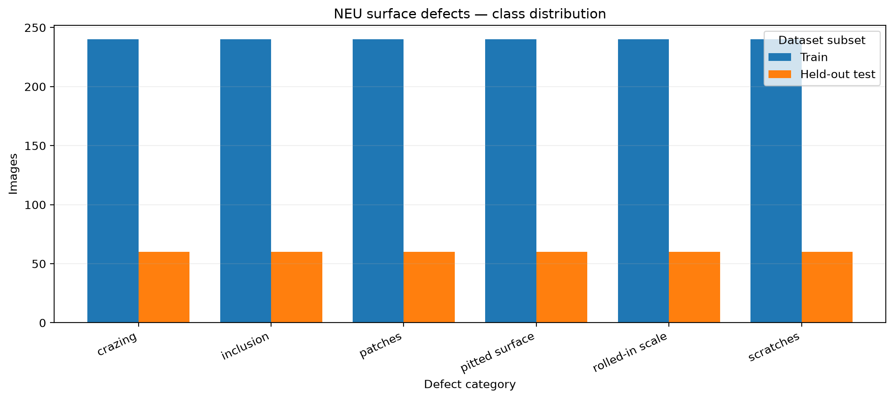
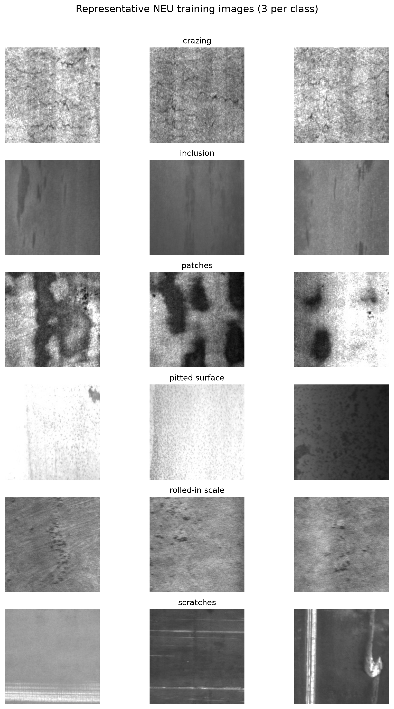
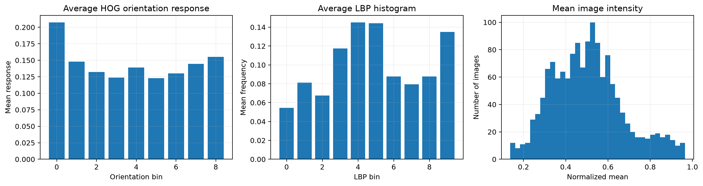
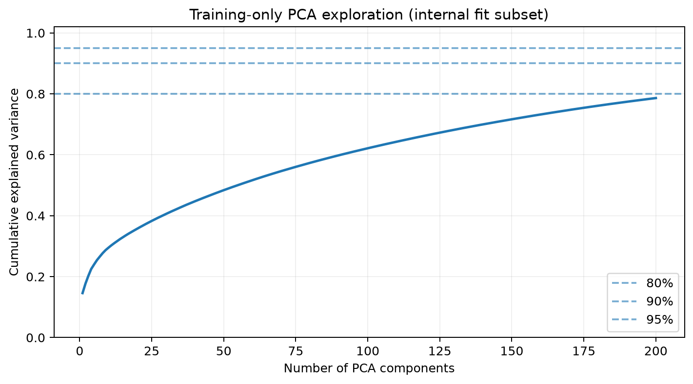
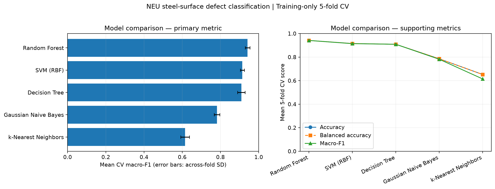
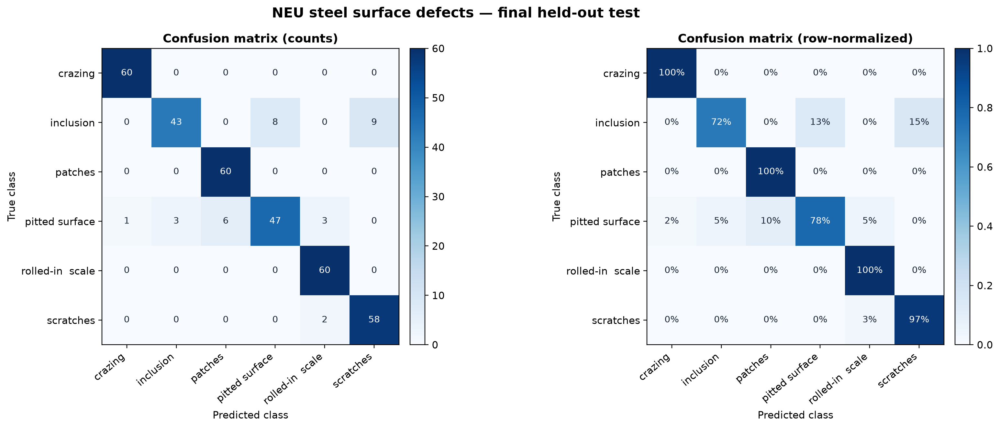
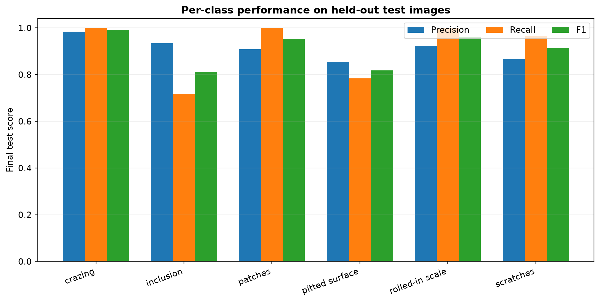
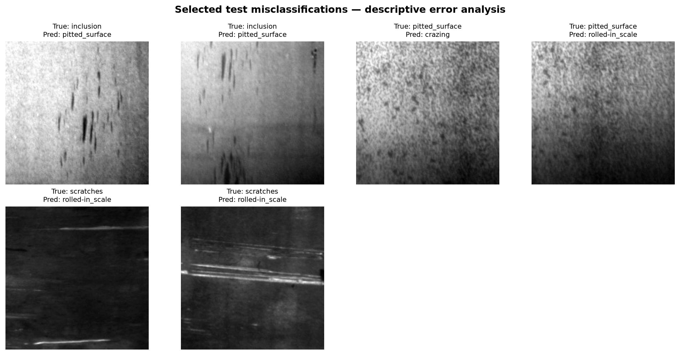

# Steel Surface Defect Classification with Classical Machine Learning

**Comparative evaluation of classical machine learning algorithms for steel surface defect classification using handcrafted image features.**

> This repository presents a complete CPU-based machine learning workflow for multiclass classification of steel surface defects using the **NEU Surface Defect Database**.  
> The project includes **dataset verification, exploratory data analysis, feature engineering, cross-validation, model selection, and final held-out test evaluation**.

---

## Project Overview

Automated surface defect recognition is an important problem in industrial quality control.  
In this project, five classical machine learning algorithms were compared for the classification of six types of steel surface defects.

Instead of training a deep neural network, this study uses **handcrafted image features**:

- **HOG** (Histogram of Oriented Gradients)
- **LBP** (Local Binary Patterns)
- **Statistical image descriptors**

These features were then used as input for the following machine learning models:

- Gaussian Naive Bayes
- Decision Tree
- k-Nearest Neighbors (k-NN)
- Support Vector Machine (SVM)
- Random Forest

The entire workflow was executed on a **CPU-only environment**, making the project lightweight and reproducible.

---

## Abstract

This project investigates the performance of five classical machine learning algorithms for multiclass steel surface defect classification using the **NEU Surface Defect Database**.  
The dataset contains **1,800 images** equally distributed among **six defect classes**.

Each image was converted to grayscale, resized to **64 × 64**, and represented using a **1,786-dimensional feature vector** composed of:

- **1,764 HOG features**
- **10 LBP histogram features**
- **12 statistical intensity/texture features**

After removing one duplicate image from the training split, **1,439 unique training images** were used for model development, while **360 images** were reserved for final held-out testing.

Model selection was performed using **stratified 5-fold cross-validation** on the training set only.  
Among the five classifiers, **Random Forest** achieved the best overall performance and was selected for final evaluation.

### Final result
- **Best model:** Random Forest
- **Cross-validation macro-F1:** **0.942**
- **Final held-out test accuracy:** **91.11%**
- **Final held-out test macro-F1:** **0.9077**

---

## Dataset

**Dataset:** NEU Surface Defect Database (NEU-DET)  
**Source:** Kaggle / original academic source

### Defect classes
- Crazing
- Inclusion
- Patches
- Pitted Surface
- Rolled-in Scale
- Scratches

### Dataset statistics

| Item | Value |
|---|---:|
| Total images | 1,800 |
| Number of classes | 6 |
| Images per class | 300 |
| Original image size | 200 × 200 |
| Training images (original split) | 1,440 |
| Training images (after deduplication) | 1,439 |
| Final held-out test images | 360 |

---

## Methodology

The workflow consists of the following stages:

1. **Dataset verification**
   - class-count validation
   - duplicate detection
   - image-mode checks

2. **Exploratory Data Analysis**
   - class distribution
   - sample image gallery
   - grayscale intensity statistics
   - basic texture/edge observations

3. **Feature Engineering**
   - grayscale conversion
   - resize to 64 × 64
   - HOG feature extraction
   - LBP histogram extraction
   - statistical feature extraction
   - PCA exploration

4. **Model Development**
   - stratified 5-fold cross-validation
   - fair comparison of 5 algorithms
   - model selection using **macro-F1**

5. **Final Evaluation**
   - one-time testing on a held-out test set
   - confusion matrix analysis
   - per-class precision / recall / F1
   - qualitative error analysis

---

## Feature Representation

Each image is represented by a combined feature vector:

- **HOG:** 1,764 features
- **LBP:** 10 features
- **Statistical descriptors:** 12 features

### Total dimensionality

**1,786 features per image**

This representation captures:
- edge orientation structure,
- local texture patterns,
- global intensity/contrast information.

---

## Visual Summary

## 1) Class distribution

## 2) Sample training images

## 3) Feature distributions

## 4) PCA explained variance

## 5) Cross-validation comparison

## 6) Final confusion matrices

## 7) Per-class metrics

## 8) Error gallery

---

## Cross-Validation Results

The best-performing configuration of each algorithm is summarized below.

| Algorithm | Macro-F1 | Accuracy | Balanced Accuracy |
|---|---:|---:|---:|
| **Random Forest** | **0.942** | **0.942** | **0.942** |
| SVM (RBF) | 0.914 | 0.915 | 0.915 |
| Decision Tree | 0.909 | 0.909 | 0.909 |
| Gaussian Naive Bayes | 0.782 | 0.786 | 0.786 |
| k-NN | 0.615 | 0.653 | 0.652 |

### Best model selected
**Random Forest** was selected based on the highest mean **5-fold cross-validation macro-F1** score.

---

## Final Held-Out Test Results

The selected Random Forest model was evaluated once on the independent test set.

| Metric | Value |
|---|---:|
| Accuracy | **0.9111** |
| Balanced Accuracy | **0.9111** |
| Macro Precision | **0.9118** |
| Macro Recall | **0.9111** |
| Macro-F1 | **0.9077** |
| Weighted F1 | **0.9077** |
| Correct predictions | **328 / 360** |

---

## Per-Class Performance

| Class | Precision | Recall | F1-score |
|---|---:|---:|---:|
| Crazing | 0.984 | 1.000 | 0.992 |
| Inclusion | 0.935 | 0.717 | 0.811 |
| Patches | 0.909 | 1.000 | 0.952 |
| Pitted Surface | 0.855 | 0.783 | 0.817 |
| Rolled-in Scale | 0.923 | 1.000 | 0.960 |
| Scratches | 0.866 | 0.967 | 0.913 |

### Interpretation
- **Crazing** was classified most reliably.
- **Patches** and **Rolled-in Scale** also achieved very strong scores.
- **Inclusion** and **Pitted Surface** were comparatively more difficult, indicating overlap in texture or visual structure.

---

## Key Findings

- Classical machine learning can achieve **strong defect classification performance** on a controlled industrial image dataset.
- Handcrafted features such as **HOG + LBP + statistical descriptors** are effective even without GPU-based deep learning.
- **Random Forest** provided the most reliable overall performance among the tested models.
- A **strict held-out test strategy** was preserved, preventing data leakage during model selection.

---